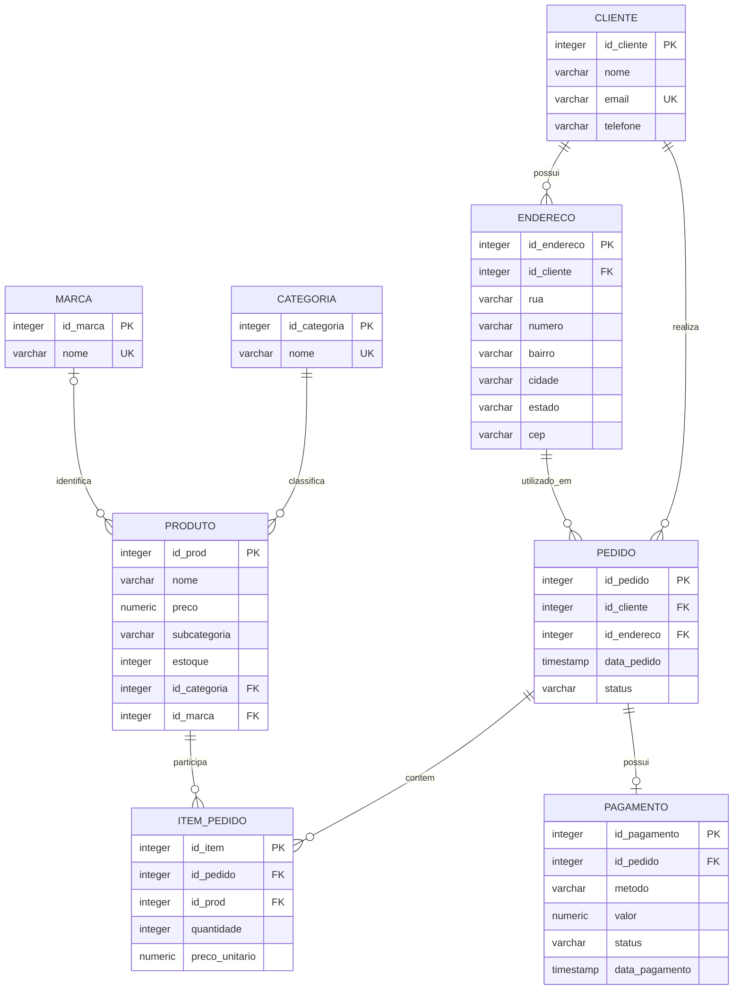

# Sistema de Gerenciamento de Vendas


## 1. Sobre o projeto

O **Sistema de Gerenciamento de Vendas** é um projeto de banco de dados relacional desenvolvido com PostgreSQL, com o objetivo de organizar e gerenciar informações relacionadas a um sistema comercial.

O banco de dados foi estruturado para armazenar e relacionar informações de clientes, endereços, produtos, categorias, marcas, pedidos, itens de pedidos e pagamentos.

O projeto aplica conceitos fundamentais de banco de dados relacionais, incluindo modelagem de dados, integridade referencial, chaves primárias, chaves estrangeiras, restrições e automatização de backups.

Os registros utilizados no ambiente de demonstração são fictícios.

## 2. Objetivos do projeto

- Desenvolver uma estrutura de banco de dados relacional.
- Organizar informações de clientes e seus endereços.
- Gerenciar produtos, categorias e marcas.
- Registrar pedidos e seus respectivos itens.
- Armazenar informações de pagamentos.
- Garantir a integridade e consistência dos dados.
- Utilizar relacionamentos entre tabelas para evitar redundância desnecessária.
- Hospedar o banco de dados na nuvem.
- Automatizar a exportação e o versionamento dos arquivos SQL.

## 3. Tecnologias utilizadas

| Tecnologia | Finalidade |
|---|---|
| PostgreSQL 18 | Sistema gerenciador do banco de dados |
| Neon | Hospedagem PostgreSQL na nuvem |
| SQL | Criação e manipulação das estruturas do banco |
| GitHub | Versionamento e armazenamento do projeto |
| GitHub Actions | Automação de tarefas e backups |
| pg_dump | Exportação e geração de arquivos SQL |

## 4. Arquitetura do projeto

O projeto utiliza uma arquitetura baseada em banco de dados relacional hospedado na nuvem.

**Funcionamento:**

1. O PostgreSQL gerencia as tabelas, relacionamentos e restrições.
2. O Neon disponibiliza o banco de dados na nuvem.
3. O GitHub armazena os arquivos SQL e a documentação.
4. O GitHub Actions executa tarefas automatizadas de exportação e atualização dos arquivos.

## 5. Estrutura do banco de dados

O banco de dados possui **8 tabelas principais**, organizadas para representar as operações de um sistema de vendas.

| Tabela | Responsabilidade |
|---|---|
| `categoria` | Cadastro das categorias de produtos |
| `cliente` | Cadastro dos clientes |
| `endereco` | Endereços associados aos clientes |
| `marca` | Cadastro das marcas |
| `produto` | Cadastro e controle de produtos |
| `pedido` | Registro dos pedidos |
| `item_pedido` | Produtos e quantidades associados aos pedidos |
| `pagamento` | Informações de pagamento dos pedidos |

## 6. Diagrama entidade-relacionamento (DER)

O diagrama apresenta as entidades e os relacionamentos existentes no banco de dados.



**Legenda:**

- PK: chave primária (*Primary Key*).
- FK: chave estrangeira (*Foreign Key*).
- UK: restrição de unicidade (*Unique Key*).
- 1:N: relacionamento de um para muitos.
- 0..1: relacionamento opcional de até um registro.

## 7. Dicionário de dados

Esta seção apresenta os campos, tipos de dados e restrições de cada tabela.

### 7.1. Tabela `categoria`

Responsável por armazenar as categorias utilizadas na classificação dos produtos.

| Campo | Tipo de dado | Restrições |
|---|---|---|
| `id_categoria` | INTEGER | PK, NOT NULL |
| `nome` | VARCHAR(40) | NOT NULL, UNIQUE |

**Regras:** cada categoria possui um identificador exclusivo e um nome que não pode se repetir.

### 7.2. Tabela `cliente`

Armazena as informações cadastrais dos clientes.

| Campo | Tipo de dado | Restrições |
|---|---|---|
| `id_cliente` | INTEGER | PK, NOT NULL |
| `nome` | VARCHAR(100) | NOT NULL |
| `email` | VARCHAR(100) | NOT NULL, UNIQUE |
| `telefone` | VARCHAR(20) | NULL |

**Regras:** cada cliente possui um identificador exclusivo e um e-mail único. O telefone é opcional.

### 7.3. Tabela `endereco`

Armazena os endereços associados aos clientes.

| Campo | Tipo de dado | Restrições |
|---|---|---|
| `id_endereco` | INTEGER | PK, NOT NULL |
| `id_cliente` | INTEGER | FK, NOT NULL |
| `rua` | VARCHAR(100) | NOT NULL |
| `numero` | VARCHAR(100) | NOT NULL |
| `bairro` | VARCHAR(60) | NOT NULL |
| `cidade` | VARCHAR(60) | NOT NULL |
| `estado` | VARCHAR(2) | NOT NULL |
| `cep` | VARCHAR(10) | NOT NULL |

**Relacionamento:** `id_cliente` referencia `cliente(id_cliente)`.

Um cliente pode possuir vários endereços, enquanto cada endereço está associado a um cliente.

### 7.4. Tabela `marca`

Armazena as marcas dos produtos cadastrados.

| Campo | Tipo de dado | Restrições |
|---|---|---|
| `id_marca` | INTEGER | PK, NOT NULL |
| `nome` | VARCHAR(70) | NOT NULL, UNIQUE |

**Regras:** cada marca possui um identificador exclusivo e um nome único.

### 7.5. Tabela `produto`

Armazena os produtos disponíveis no sistema.

| Campo | Tipo de dado | Restrições |
|---|---|---|
| `id_prod` | INTEGER | PK, NOT NULL |
| `nome` | VARCHAR(70) | NOT NULL |
| `preco` | NUMERIC(7,2) | NOT NULL |
| `subcategoria` | VARCHAR(50) | NOT NULL |
| `estoque` | INTEGER | NOT NULL |
| `id_categoria` | INTEGER | FK, NOT NULL |
| `id_marca` | INTEGER | FK, NULL |

**Relacionamentos:**

- `id_categoria` referencia `categoria(id_categoria)`.
- `id_marca` referencia `marca(id_marca)`.

**Regras de integridade:**

- O preço deve ser maior que zero.
- O estoque não pode ser negativo.
- A categoria é obrigatória.
- A marca é opcional.

### 7.6. Tabela `pedido`

Registra os pedidos realizados pelos clientes.

| Campo | Tipo de dado | Restrições |
|---|---|---|
| `id_pedido` | INTEGER | PK, NOT NULL |
| `id_cliente` | INTEGER | FK, NOT NULL |
| `id_endereco` | INTEGER | FK, NOT NULL |
| `data_pedido` | TIMESTAMP | DEFAULT CURRENT_TIMESTAMP |
| `status` | VARCHAR(30) | DEFAULT 'pendente' |

**Relacionamentos:**

- `id_cliente` referencia `cliente(id_cliente)`.
- `id_endereco` referencia `endereco(id_endereco)`.

**Regras:** todo pedido deve estar associado a um cliente e a um endereço cadastrado. A data e o status possuem valores padrão.

### 7.7. Tabela `item_pedido`

Relaciona os produtos aos pedidos, armazenando as quantidades e os preços unitários.

| Campo | Tipo de dado | Restrições |
|---|---|---|
| `id_item` | INTEGER | PK, NOT NULL |
| `id_pedido` | INTEGER | FK, NOT NULL |
| `id_prod` | INTEGER | FK, NOT NULL |
| `quantidade` | INTEGER | NOT NULL |
| `preco_unitario` | NUMERIC(10,2) | NOT NULL |

**Relacionamentos:**

- `id_pedido` referencia `pedido(id_pedido)`.
- `id_prod` referencia `produto(id_prod)`.

**Regras de integridade:**

- A quantidade deve ser maior que zero.
- O preço unitário deve ser maior que zero.
- A combinação `id_pedido` e `id_prod` deve ser única.

Essa tabela permite relacionar vários produtos a um pedido e um mesmo produto a diferentes pedidos.

### 7.8. Tabela `pagamento`

Armazena as informações dos pagamentos associados aos pedidos.

| Campo | Tipo de dado | Restrições |
|---|---|---|
| `id_pagamento` | INTEGER | PK, NOT NULL |
| `id_pedido` | INTEGER | FK, NOT NULL, UNIQUE |
| `metodo` | VARCHAR(40) | NOT NULL |
| `valor` | NUMERIC(10,2) | NOT NULL |
| `status` | VARCHAR(30) | DEFAULT 'pendente' |
| `data_pagamento` | TIMESTAMP | NULL |

**Relacionamento:** `id_pedido` referencia `pedido(id_pedido)`.

**Regras de integridade:**

- O valor do pagamento deve ser maior que zero.
- Cada pedido pode possuir no máximo um pagamento.
- O status assume `pendente` quando não informado.
- A data do pagamento é opcional.

## 8. Relacionamentos e cardinalidades

| Relacionamento | Cardinalidade | Descrição |
|---|---|---|
| Cliente → Endereço | 1:N | Um cliente pode possuir vários endereços. |
| Cliente → Pedido | 1:N | Um cliente pode realizar vários pedidos. |
| Endereço → Pedido | 1:N | Um endereço pode ser utilizado em vários pedidos. |
| Categoria → Produto | 1:N | Uma categoria pode classificar vários produtos. |
| Marca → Produto | 1:N | Uma marca pode identificar vários produtos. |
| Pedido → Item de pedido | 1:N | Um pedido pode possuir vários itens. |
| Produto → Item de pedido | 1:N | Um produto pode aparecer em vários itens de pedidos. |
| Pedido → Pagamento | 1:0..1 | Um pedido pode não possuir pagamento ou possuir um pagamento. |

**Observação:** as cardinalidades representam as regras estabelecidas pelas chaves estrangeiras e restrições presentes na estrutura SQL. A existência de pelo menos um item por pedido, por exemplo, não é imposta diretamente pelo banco.

## 9. Integridade e restrições do banco

O projeto utiliza diferentes mecanismos de integridade para manter a consistência das informações.

### PRIMARY KEY

Identifica exclusivamente cada registro de uma tabela.

### FOREIGN KEY

Estabelece relacionamentos entre tabelas e impede referências a registros inexistentes.

### UNIQUE

Impede a duplicidade de valores ou combinações de valores.

Restrições utilizadas:

- `categoria.nome`
- `cliente.email`
- `marca.nome`
- `item_pedido(id_pedido, id_prod)`
- `pagamento.id_pedido`

### NOT NULL

Determina que um campo deve obrigatoriamente receber um valor.

### CHECK

Valida condições específicas:

| Restrição | Regra |
|---|---|
| `produto_preco_check` | Preço maior que zero |
| `produto_estoque_check` | Estoque igual ou maior que zero |
| `item_pedido_quantidade_check` | Quantidade maior que zero |
| `item_pedido_preco_unitario_check` | Preço unitário maior que zero |
| `pagamento_valor_check` | Valor maior que zero |

### DEFAULT

Define valores automaticamente quando não são informados.

Exemplos:

- `pedido.data_pedido`: data e hora atuais.
- `pedido.status`: `pendente`.
- `pagamento.status`: `pendente`.

### SEQUENCES

O PostgreSQL utiliza sequências para gerar automaticamente os identificadores das tabelas.

## 10. Como instalar e reproduzir o banco de dados

O arquivo `database/estrutura.sql` contém os comandos necessários para criar a estrutura do banco.

### Pré-requisitos

- PostgreSQL instalado ou acesso a uma instância PostgreSQL.
- Uma ferramenta para executar comandos SQL, como pgAdmin ou SQL Editor do Neon.

### Passo 1 — Criar um banco vazio

Crie um novo banco de dados PostgreSQL para receber a estrutura.

### Passo 2 — Executar o arquivo SQL

Abra o arquivo:

`database/estrutura.sql`

Copie seu conteúdo e execute no banco vazio utilizando o pgAdmin ou o SQL Editor do Neon.

Também é possível executar pelo terminal com o cliente `psql`:

```bash
psql -h HOST -U USUARIO -d NOME_DO_BANCO -f database/estrutura.sql
```

Substitua `HOST`, `USUARIO` e `NOME_DO_BANCO` pelos dados da sua própria conexão.

### Passo 3 — Verificar as tabelas

Após a execução, verifique se as oito tabelas foram criadas:

- categoria
- cliente
- endereco
- item_pedido
- marca
- pagamento
- pedido
- produto

**Importante:** o arquivo `estrutura.sql` cria as tabelas, sequências, chaves e restrições, mas não insere os registros de demonstração.

Para reproduzir também os dados, utilize um arquivo de backup completo, em um banco de testes vazio.

## 11. Backups e versionamento

O projeto utiliza GitHub Actions para automatizar a exportação dos arquivos do banco de dados hospedado no Neon.

Quando configurado, o workflow pode ser executado automaticamente por agendamento ou manualmente pela aba Actions do GitHub.

O processo de exportação utiliza `pg_dump`, ferramenta oficial do PostgreSQL.

Os arquivos SQL permitem documentar, versionar e recuperar a estrutura ou os dados de demonstração do banco, conforme o tipo de exportação utilizado.

### Tipos de exportação

| Tipo | Conteúdo |
|---|---|
| Estrutura (`--schema-only`) | Tabelas, sequências, chaves e restrições |
| Backup completo | Estrutura e registros existentes |
| Backup individual | Exportação de uma tabela específica |

As exportações completas devem ser utilizadas somente em ambientes com dados apropriados para compartilhamento.

**Segurança:** as credenciais de conexão do Neon devem ser armazenadas nos Secrets do GitHub Actions, nunca diretamente nos arquivos do repositório.

## 12. Organização do repositório

A organização dos arquivos pode ser apresentada da seguinte forma:

```text
projeto-banco-de-dados/
│
├── .github/
│   └── workflows/
│       └── backup-neon.yml
│
├── database/
│   ├── README.md
│   ├── estrutura.sql
│   ├── database_completa.sql
│   │
│   └── tabelas/
│       ├── public__categoria.sql
│       ├── public__cliente.sql
│       ├── public__endereco.sql
│       ├── public__item_pedido.sql
│       ├── public__marca.sql
│       ├── public__pagamento.sql
│       ├── public__pedido.sql
│       └── public__produto.sql
│
└── README.md
```

A presença dos arquivos de backup depende da configuração e da execução do workflow.

## 13. Possibilidades de expansão

A estrutura atual pode servir como base para futuras funcionalidades, como:

- Interface web para gerenciamento de produtos.
- Cadastro, consulta e atualização de clientes.
- Gerenciamento de estoque.
- Criação e acompanhamento de pedidos.
- Consulta ao histórico de vendas.
- Relatórios de faturamento.
- Integração com sistemas de pagamento.
- Painel administrativo.

## 14. Considerações finais

O projeto demonstra a aplicação prática dos conceitos de bancos de dados relacionais por meio da construção de uma estrutura organizada, com relacionamentos bem definidos e regras de integridade.

A utilização do PostgreSQL permite gerenciar as informações com consistência, enquanto o Neon oferece hospedagem em nuvem e o GitHub possibilita o versionamento, a documentação e a automação de tarefas.

A estrutura foi desenvolvida para servir como base para um sistema de gerenciamento de vendas e futuras integrações com aplicações web.

---

**Projeto acadêmico — Banco de Dados**

Tecnologias: PostgreSQL 18, Neon, SQL e GitHub.
