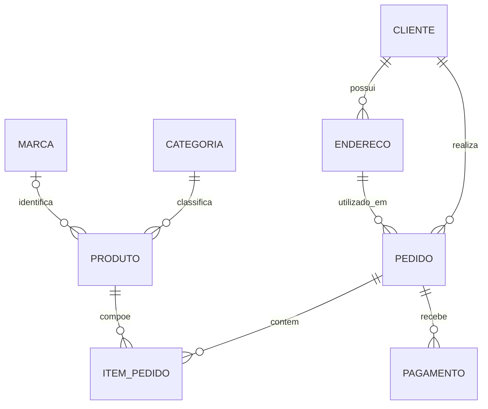

# Sistema de Gerenciamento de Vendas

## 1. Sobre o projeto

Este projeto consiste em um banco de dados relacional desenvolvido em PostgreSQL e hospedado na plataforma Neon.

O objetivo é organizar e gerenciar informações relacionadas a clientes, produtos, categorias, marcas, endereços, pedidos, itens de pedidos e pagamentos.

O banco utiliza relacionamentos entre tabelas para manter a organização e a integridade das informações.

## 2. Tecnologias utilizadas

- **PostgreSQL:** sistema de gerenciamento do banco de dados.
- **Neon:** plataforma de hospedagem do banco PostgreSQL.
- **GitHub:** armazenamento e versionamento dos arquivos do projeto.
- **GitHub Actions:** automação da exportação e atualização dos arquivos SQL.

## 3. Estrutura do banco de dados

O banco possui 8 tabelas:

| Tabela | Descrição |
|---|---|
| categoria | Armazena as categorias dos produtos. |
| cliente | Armazena os dados dos clientes. |
| endereco | Armazena os endereços cadastrados dos clientes. |
| marca | Armazena as marcas dos produtos. |
| produto | Armazena as informações dos produtos. |
| pedido | Registra os pedidos realizados pelos clientes. |
| item_pedido | Registra os produtos e quantidades de cada pedido. |
| pagamento | Armazena as informações de pagamento dos pedidos. |

## 4. Dicionário de dados

### 4.1. Tabela: categoria

Armazena as categorias utilizadas para classificar os produtos.

| Campo | Tipo | Restrição |
|---|---|---|
| id_categoria | INTEGER | PK, NOT NULL |
| nome | VARCHAR | NOT NULL |

### 4.2. Tabela: cliente

Armazena as informações dos clientes cadastrados.

| Campo | Tipo | Restrição |
|---|---|---|
| id_cliente | INTEGER | PK, NOT NULL |
| nome | VARCHAR | NOT NULL |
| email | VARCHAR | NOT NULL |
| telefone | VARCHAR | NULL permitido |

### 4.3. Tabela: endereco

Armazena os endereços associados aos clientes.

| Campo | Tipo | Restrição |
|---|---|---|
| id_endereco | INTEGER | PK, NOT NULL |
| id_cliente | INTEGER | FK, NOT NULL |
| rua | VARCHAR | NOT NULL |
| numero | VARCHAR | NOT NULL |
| bairro | VARCHAR | NOT NULL |
| cidade | VARCHAR | NOT NULL |
| estado | VARCHAR | NOT NULL |
| cep | VARCHAR | NOT NULL |

Relacionamento: `id_cliente` referencia `cliente.id_cliente`.

### 4.4. Tabela: marca

Armazena as marcas dos produtos cadastrados.

| Campo | Tipo | Restrição |
|---|---|---|
| id_marca | INTEGER | PK, NOT NULL |
| nome | VARCHAR | NOT NULL |

### 4.5. Tabela: produto

Armazena os produtos disponíveis no sistema.

| Campo | Tipo | Restrição |
|---|---|---|
| id_prod | INTEGER | PK, NOT NULL |
| nome | VARCHAR | NOT NULL |
| preco | NUMERIC | NOT NULL |
| subcategoria | VARCHAR | NOT NULL |
| estoque | INTEGER | NOT NULL |
| id_categoria | INTEGER | FK, NOT NULL |
| id_marca | INTEGER | FK, NULL permitido |

Relacionamentos:
- `id_categoria` referencia `categoria.id_categoria`.
- `id_marca` referencia `marca.id_marca`.

### 4.6. Tabela: pedido

Registra os pedidos realizados pelos clientes.

| Campo | Tipo | Restrição |
|---|---|---|
| id_pedido | INTEGER | PK, NOT NULL |
| id_cliente | INTEGER | FK, NOT NULL |
| id_endereco | INTEGER | FK, NOT NULL |
| data_pedido | TIMESTAMP | NULL permitido |
| status | VARCHAR | NULL permitido |

Relacionamentos:
- `id_cliente` referencia `cliente.id_cliente`.
- `id_endereco` referencia `endereco.id_endereco`.

### 4.7. Tabela: item_pedido

Armazena os produtos que fazem parte de cada pedido.

| Campo | Tipo | Restrição |
|---|---|---|
| id_item | INTEGER | PK, NOT NULL |
| id_pedido | INTEGER | FK, NOT NULL |
| id_prod | INTEGER | FK, NOT NULL |
| quantidade | INTEGER | NOT NULL |
| preco_unitario | NUMERIC | NOT NULL |

Relacionamentos:
- `id_pedido` referencia `pedido.id_pedido`.
- `id_prod` referencia `produto.id_prod`.

### 4.8. Tabela: pagamento

Armazena os pagamentos relacionados aos pedidos.

| Campo | Tipo | Restrição |
|---|---|---|
| id_pagamento | INTEGER | PK, NOT NULL |
| id_pedido | INTEGER | FK, NOT NULL |
| metodo | VARCHAR | NOT NULL |
| valor | NUMERIC | NOT NULL |
| status | VARCHAR | NULL permitido |
| data_pagamento | TIMESTAMP | NULL permitido |

Relacionamento: `id_pedido` referencia `pedido.id_pedido`.

## 5. Chaves primárias e estrangeiras

### Chaves primárias (PK)

As chaves primárias identificam exclusivamente cada registro.

- categoria: `id_categoria`
- cliente: `id_cliente`
- endereco: `id_endereco`
- marca: `id_marca`
- produto: `id_prod`
- pedido: `id_pedido`
- item_pedido: `id_item`
- pagamento: `id_pagamento`

### Chaves estrangeiras (FK)

As chaves estrangeiras estabelecem os relacionamentos entre as tabelas.

| Tabela | Campo | Tabela referenciada |
|---|---|---|
| endereco | id_cliente | cliente.id_cliente |
| produto | id_categoria | categoria.id_categoria |
| produto | id_marca | marca.id_marca |
| pedido | id_cliente | cliente.id_cliente |
| pedido | id_endereco | endereco.id_endereco |
| item_pedido | id_pedido | pedido.id_pedido |
| item_pedido | id_prod | produto.id_prod |
| pagamento | id_pedido | pedido.id_pedido |

## 6. Diagrama de relacionamentos

O diagrama abaixo representa as relações identificadas entre as oito tabelas.



## 7. Tipos de dados utilizados

- **INTEGER:** números inteiros, utilizados principalmente para identificadores, quantidades e estoque.
- **VARCHAR:** textos de tamanho variável, utilizados para nomes, endereços, e-mails e informações descritivas.
- **NUMERIC:** valores numéricos que permitem representar preços e valores monetários.
- **TIMESTAMP WITHOUT TIME ZONE:** armazena datas e horários sem informação de fuso horário.

## 8. Integridade dos dados

O banco utiliza chaves primárias e estrangeiras para organizar os registros e estabelecer relacionamentos.

Os campos obrigatórios utilizam a restrição `NOT NULL`, enquanto os campos opcionais permitem valores nulos.

Essas restrições ajudam a manter a consistência das informações armazenadas.

## 9. Backup e versionamento

O banco de dados está hospedado no Neon e possui uma integração com o GitHub por meio do GitHub Actions.

Foi configurada uma automação que executa periodicamente as seguintes tarefas:

1. Acessa o banco PostgreSQL hospedado no Neon.
2. Exporta a estrutura e os registros do banco.
3. Gera um arquivo SQL completo.
4. Gera arquivos SQL individuais para cada tabela.
5. Atualiza os arquivos no repositório GitHub quando existem alterações.

A execução automática está programada para ocorrer a cada hora, além de permitir execução manual.

## 10. Organização dos arquivos

```text
projeto-banco-de-dados/
│
├── .github/
│   └── workflows/
│       └── backup-neon.yml
│
├── database/
│   ├── database_completa.sql
│   ├── README.md
│   └── tabelas/
│       ├── public__categoria.sql
│       ├── public__cliente.sql
│       ├── public__endereco.sql
│       ├── public__marca.sql
│       ├── public__produto.sql
│       ├── public__pedido.sql
│       ├── public__item_pedido.sql
│       └── public__pagamento.sql
│
└── README.md
```

## 11. Considerações finais

O projeto demonstra a utilização de um banco de dados relacional PostgreSQL, com organização de tabelas, definição de chaves primárias e estrangeiras e relacionamentos entre entidades.

A utilização do Neon permite hospedar o banco de dados na nuvem, enquanto o GitHub e o GitHub Actions permitem versionar e automatizar a atualização dos arquivos SQL.

Dessa forma, o projeto mantém uma estrutura organizada, documentada e preparada para futuras melhorias.
